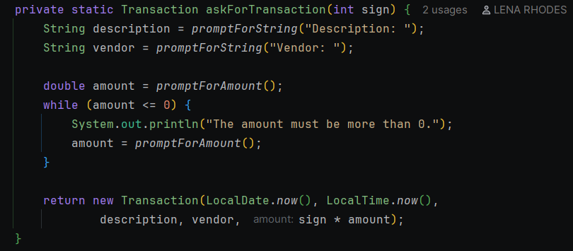

# Pocket Ledger (Accounting Ledger)

A command-line app that tracks every deposit and payment for a business or for personal use.
Transactions are saved in transactions.csv, and you can look at them in a ledger or run reports by month, year, or vendor.

### Features

- Add a deposit or make a payment, and each one is saved to transactions.csv
- Ledger screen: all transactions, deposits only, or payments only, with the oldest first and the newest at the bottom
- Reports: Month To Date, Previous Month, Year To Date, Previous Year, and Search by Vendor
- Custom Search: answer only the questions you care about and press Enter to skip the rest
- A count and a total under every list, like 4 transactions and Total: $6,410.00
- Bad input never crashes the app: it explains the problem and asks again
- A line in the data file that can't be read is skipped with a message, instead of stopping the app
- A welcome banner when the app starts
- Long lists show 20 at a time, with Enter for more or Q to stop

### How to Run It
1. Clone the repository and open it in IntelliJ
2. Make sure transactions.csv is in the project's top folder, next to pom.xml
3. Run App.java
4. Type a letter from the menu, like L for the ledger

### Screen Map

### Screenshots

    private static void displayWelcomeBanner() {
        System.out.println(style("P O C K E T L E D G E R", BOLD));
        System.out.println(style(TITLE_LINE, GRAY));
        System.out.println(style(" Every dollar in, Every dollar out  ", GRAY));
    }

    private static void runHomeScreen() {
        String command;
        do {
            displayTitle("Home");
            double balance = calculateTotal(transactions);
            System.out.println("Current balance: " + colorAmount(formatMoney(balance), balance));
            System.out.println();
            System.out.println("D) Add Deposit");
            System.out.println("P) Make Payment");
            System.out.println("L) Ledger");
            System.out.println("X) Exit");
            System.out.println();
            System.out.print("Enter a command: ");
            command = scanner.nextLine().trim().toUpperCase();

            switch (command) {
                case "D" -> addDeposit();
                case "P" -> makePayment();
                case "L" -> runLedgerScreen();
                case "X" -> System.out.println("Goodbye!");
                default -> System.out.println("That isn't a command. Try again.");
            }
        } while (!command.equals("X"));
    }

### Custom Search

Option 6) Custom Search on the Reports screen asks five questions: start date, end date, description, vendor, and amount. 
Answer the ones you care about and press Enter to skip the others. A skipped question doesn't filter anything, and a transaction has to match every answer you gave to show up.

For example, what happened between October 18 and October 31, 2026? Only the two dates are filled in, so the description, vendor, and amount are skipped:

- Dates include the start and end days
- Description and vendor match part of the text, ignoring capitals (`star` finds Starbucks)
- Amount must match exactly, so type `-89.50` to find a payment
- A typo asks again, and a start date after the end date shows a message

### Interesting Code
A deposit and a payment are the same kind of thing, so the app has one transaction class and one list. 
The only difference is the sign of the amount: positive for a deposit, negative for a payment. 
askForTransaction() asks the same questions for both and multiplies the amount by sign, which is 1 for a deposit and -1 for a payment. 
The user always types a positive number, so a payment can't be saved as a deposit by mistake: 

Because payments are negative, the rest of the app needs no special cases.
The Deposits list keeps the amounts above 0, the Payments list keeps the amounts below 0, and the balance is just every amount added together:

The same method gives the total under every list and every report, from Deposits (all positive) to Search by Vendor (a mix).

### Author
Lena Rhodes, Year Up Java Academy

